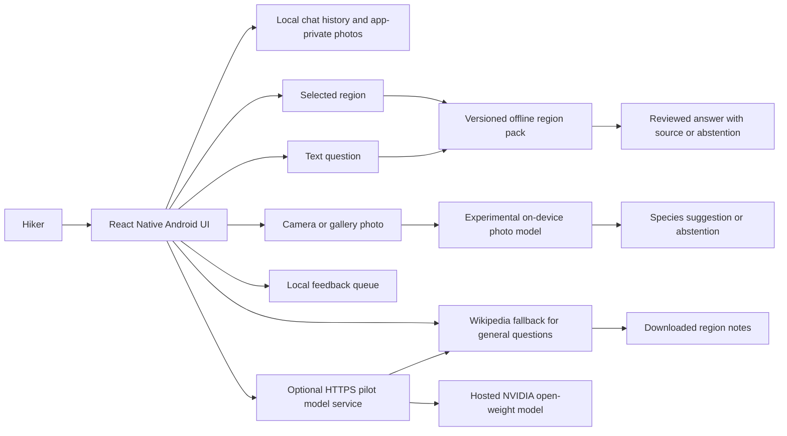

# WILD-AI v1 architecture

## Pilot target

An English Android app for 5–10 hikers and trekkers in Uttarakhand. Users
choose a region before going offline. Mussoorie and Landour map to Dehradun;
statewide information is available throughout Uttarakhand. Region-specific
information appears only where its coverage has been verified. The November
2026 field pilot is gated on expert review and independent validation.

## On-device flow

The app needs no network to answer a curated question. General questions can
receive a linked Wikipedia fallback, and a configured HTTPS service can add a
source-grounded model summary. Both are labelled unreviewed and do not replace
local safety guidance. The service receives the question, region, and up to 12
recent text turns; full conversations and photos remain in app-private storage.
Feedback remains on device until shared. The provider key stays server-side.

The debug and pilot builds allow an experimental 12-species photo model;
release builds still require an approved model. A phone call still needs
cellular coverage. The current question path retrieves relevant curated
records by region, topic, and species name, then assembles fixed, sourced
passages. It is a small offline retrieval-augmented answer system, not an
open-ended language model or semantic embedding search.

## Content and model boundaries

- **Region pack:** 25 occurrence records and a small field guide set are
  bundled in `src/knowledgePack.ts`. Each record includes a source and a
  conservative area. These records are source checked but still need botanist
  and field expert sign-off. Unknown local coverage yields abstention.
- **Question answering:** local lexical retrieval and fixed passage assembly
  keep answers traceable. Food-use records describe species, never an item
  found by the user. Toxicity and medical questions abstain. Add semantic
  retrieval only after a representative question set shows it improves recall
  without unsafe matches.
- **Plant identification:** 20–30 expert-verified species with look-alikes,
  region metadata, a distinct unknown-plant test set, and calibrated
  abstention. A species suggestion is not permission to eat or handle a plant.
- **Remote training:** curated, licensed photos go to the user's hosted Google
  Colab runtime. The [notebook](training/WILD_AI_Colab.ipynb) exports a model
  candidate, label order, and evaluation record. Candidate files are reviewed
  before being copied into Android assets and shipped through Google Play.
- **Privacy:** chat and photos stay on the device. Online search sends the
  question and region to Wikimedia; model requests also send recent text turns
  to the configured service and provider. Feedback is stored locally and shared only
  when the user chooses to export it.

## Acceptance gates for the field pilot

1. Verify source, geographic coverage, and expert sign-off for every safety
   entry; test roughly 200 representative and out-of-scope questions.
2. Independently test every plant class and dangerous look-alike on photos
   from unseen observations, photographers, routes, and devices. Report
   per-class errors, unknown false accepts, and abstention rate.
3. Measure fresh-install offline behavior, camera operation, latency, memory,
   and app size on a mid-range Android phone. Confirm curated answers still
   work in airplane mode and the model labels match the bundled model.
4. Run a supervised 5–10 participant closed pilot. Capture usability and
   failure reports without presenting unreviewed safety guidance as fact.

## Current state

The Android project now uses a persistent chat interface with camera and
gallery attachment, a drawer for region and offline controls, source-labelled
answers, feedback, and gentle reduced-motion-aware forest animation. A
debug-key-signed pilot APK is available. The NVIDIA-backed online service is
implemented but awaits an HTTPS deployment and provider credentials. The
release gates remain open: the photo model is experimental and the guidance
needs expert sign-off.
